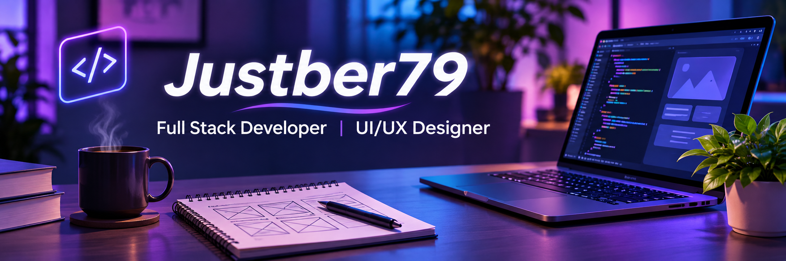

## ✨ About Me

I'm a full-stack software developer with a background in UI/UX design. I combine technical problem-solving with a user-centered approach to build intuitive, accessible, and responsive applications.

I use AI tools in my development workflow and explore ways to integrate AI technologies into useful digital experiences.

---

## ⚡ Tech Stack

### Frontend

### Backend & Databases

### Tools & Design

### AI Tools & Technologies

---

## 🚀 What I Work On

- 💻 Modern web applications with React, Next.js, and TypeScript
- 🎨 Accessible, responsive, and user-centered interfaces
- 🤖 AI-assisted development and AI-powered applications
- ⚙️ Full-stack applications, APIs, and databases

---

## 🌐 Let's Connect

I'm open to software engineering opportunities, interesting projects, and collaborations where I can contribute my development and design skills.

---

*Code. Create. Innovate.*

